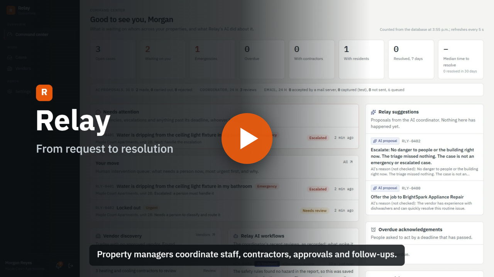
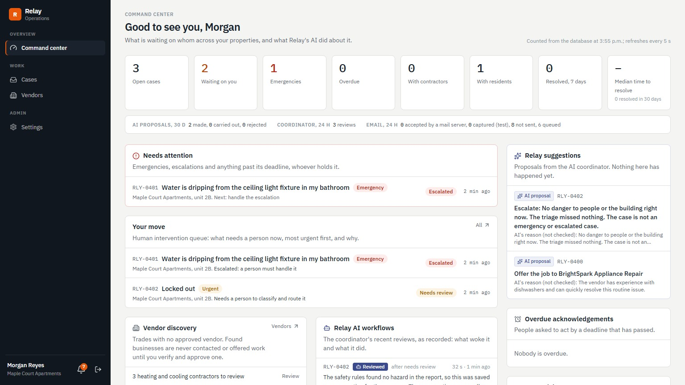
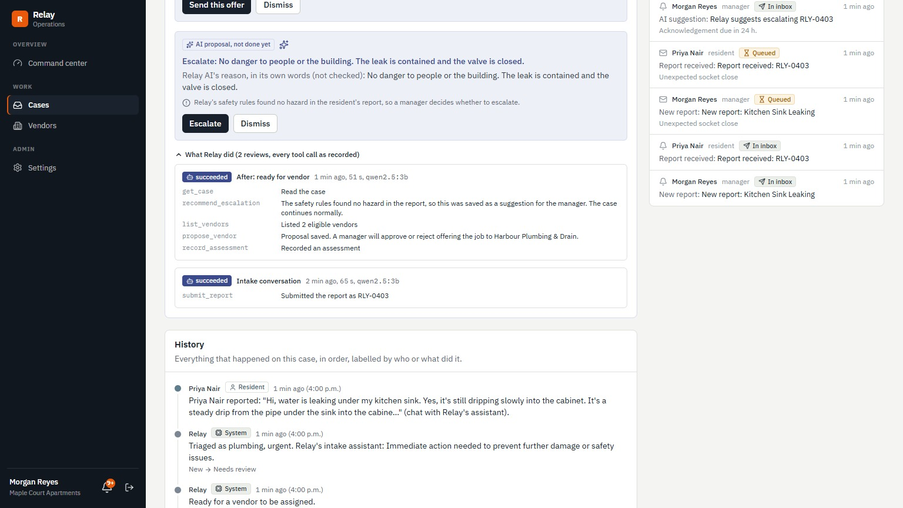
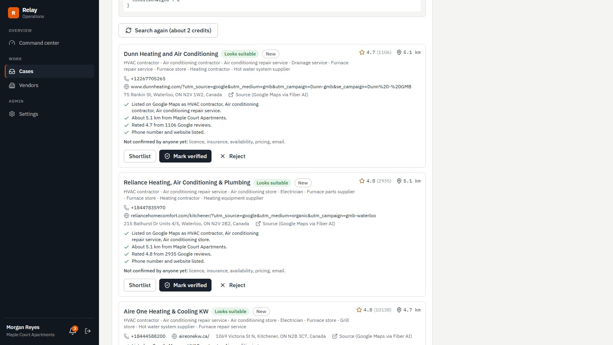
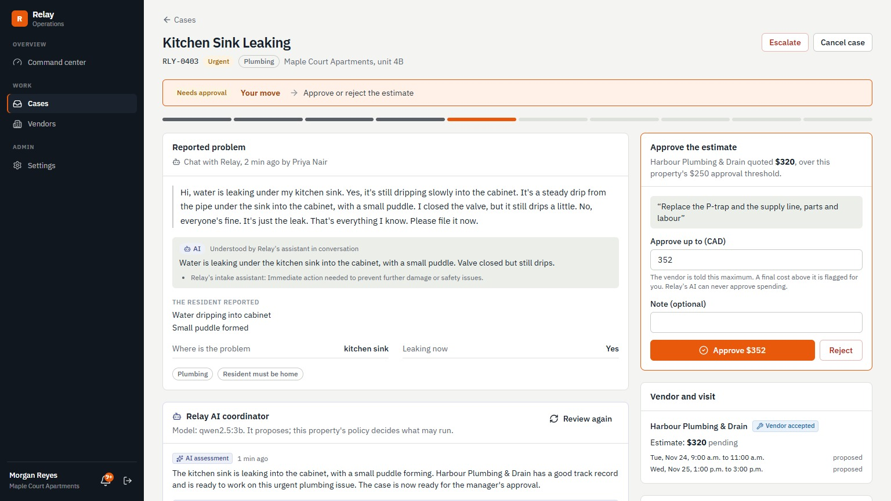
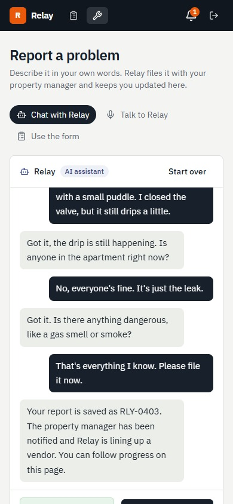
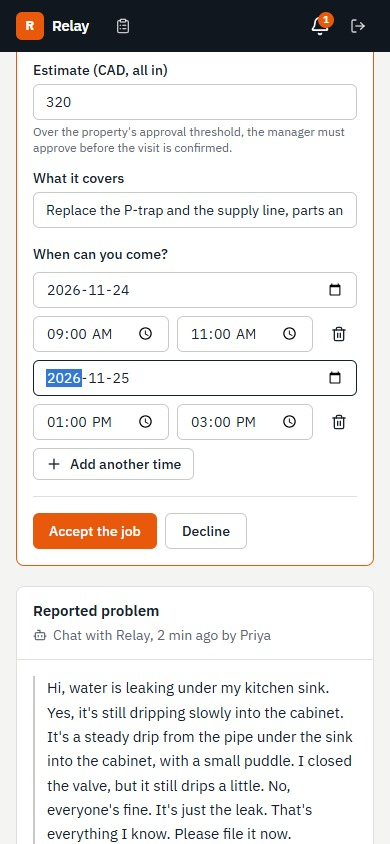
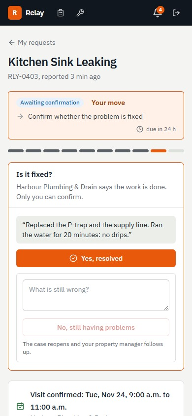
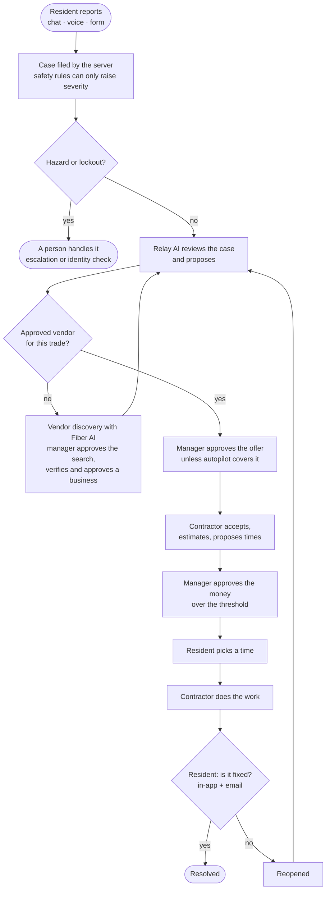
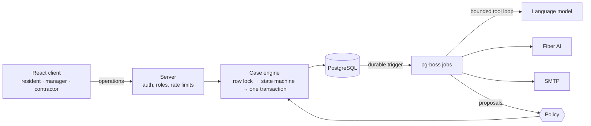

<div align="center">

# Relay

**The AI operations coordinator for residential buildings.**
**From resident request to accountable resolution.**

Residents report problems in their own words. Relay turns each report into a tracked case and coordinates it with
the property manager, the contractor and the resident through approvals, scheduling and follow-up until the resident
confirms the fix. Every step is recorded, and people stay in control of the decisions that matter.

[**▶ Watch the product demo**](https://github.com/elaineh16/yc-hackathon/releases/download/relay-v1.1-preview/relay-product-demo.mp4)
· [See it work](#product-screenshots) · [How it works](#how-it-works) · [Run it locally](#run-it-locally) · [Technical deep dive](#technical-deep-dive)

</div>

## Watch Relay in action

[](https://github.com/elaineh16/yc-hackathon/releases/download/relay-v1.1-preview/relay-product-demo.mp4)

**[Relay: from request to resolution](https://github.com/elaineh16/yc-hackathon/releases/download/relay-v1.1-preview/relay-product-demo.mp4)**
(5 min 26 s, 1080p, narrated; captions:
[SRT](https://github.com/elaineh16/yc-hackathon/releases/download/relay-v1.1-preview/relay-product-demo.srt) ·
[VTT](https://github.com/elaineh16/yc-hackathon/releases/download/relay-v1.1-preview/relay-product-demo.vtt))

One leak, three people, one case. Everything in the video is the real application, recorded in Chrome:

- a resident reports the leak by chatting with Relay, and a local language model asks a follow-up question before
  filing;
- the manager sees what Relay understood, what it proposed, and what actually ran;
- a **live Fiber AI search** finds real local HVAC businesses for a building with no approved contractor (discovery,
  not approval);
- the contractor accepts with an estimate, the manager approves the money, the resident picks a time, the work is
  done;
- Relay asks the resident whether it is really fixed, in the app and by email (a local test inbox); "Yes, resolved"
  closes the case, and "No, still having problems" reopens another one;
- an unclear request, a possible emergency, a lockout, and a contractor who cannot open someone else's job.

The only edits are cuts of the model's thinking time (marked on screen), some stretches played up to 1.6 times
faster, zooms, captions and narration (a local open-source voice). Outcomes are never changed.

## Product screenshots

Frames from the demo recording of the running application.

| The manager's command center | The case workspace: what Relay understood, proposed and did |
| --- | --- |
|  |  |
| **A live Fiber AI search: real businesses, checked, never contacted** | **Money is a person's decision** |
|  |  |

| Resident: chat intake | Contractor: accept, estimate, propose times | Resident: "Is it fixed?" |
| --- | --- | --- |
|  |  |  |

More, at desktop, tablet and phone sizes: [docs/screenshots/v1.1/](docs/screenshots/v1.1/).

## How it works



The model reads and proposes; deterministic code decides what may happen. Each case always has a state, an owner, a
next action and a recorded history labelled by who did each step: the resident, Relay's AI, the system, the
manager or the vendor.

## Features

- **Conversational intake.** Residents chat with Relay, use voice (ElevenLabs), or fill in a plain form that needs
  no AI. Relay asks before filing a vague report, keeps what the resident said apart from what it assumed, and
  gives safety advice. The server files the case; the confirmation comes from the database, not the model.
- **AI coordination.** On every case event, a coordinator reads the case, the building's approved vendors, building
  notes and past cases, and proposes the next step. It records every tool call. It can never approve money,
  schedule, close a case or contact a discovered business.
- **Vendor discovery with Fiber AI.** When a building has no approved contractor for a trade, Relay can search for
  local businesses through the official Fiber AI SDK. It sends only the trade and the city, checks every result
  (a business? the right trade? in the area? contact details? already a vendor?), and keeps the best three. Nothing
  found is contacted or offered work until a manager verifies it and approves it for the property. Searches are
  budgeted and cached.
- **Approvals.** Offers wait for the manager unless the property's autopilot covers routine work. An estimate over
  the property's threshold needs the manager's approval with a cap. A contractor asking for more money needs
  another approval.
- **Scheduling.** The contractor proposes times, and the resident picks one. The visit is confirmed only when
  everyone required has agreed, with reminders before it.
- **Automated follow-ups.** In-app notifications, plus email for people who opt in. Relay asks whether it is really
  fixed, chases what is overdue with bounded reminders, and tells the manager when it cannot proceed. Every
  delivery is recorded as what it really was: a local test inbox counts as "captured", never "delivered".
- **Safety routing.** Gas, smoke, sparks, flooding, water near electrics, someone at risk: escalated to a person,
  never dispatched as routine work. Lockouts go to staff for an identity check, and no access code is ever shared.

## Under the hood

| Layer | Technology |
| --- | --- |
| App | [Wasp](https://wasp.sh) 0.22: React 19, Node, Prisma 5, PostgreSQL; Tailwind CSS 4, Radix, IBM Plex |
| Case engine | A state machine; each transition runs under a row lock in one transaction, with idempotency keys |
| Background work | pg-boss jobs: chat turns, coordinator reviews, vendor discovery, a minute sweep for deadlines and lost work |
| AI | Any OpenAI-compatible model; by default a local Ollama `qwen2.5:3b` (free, offline, private). Bounded tool loops; policy modules decide |
| Integrations | Fiber AI SDK (vendor discovery), ElevenLabs Agents (voice), nodemailer with Mailpit locally (email), TraceRoot (traces) |
| Tests | Node test runner (unit and HTTP API), Playwright in Chrome, an AI evaluation harness, GitHub Actions |



Read more: [architecture](docs/architecture.md) · [workflow and states](docs/workflow.md) ·
[agents, tools and policy](docs/agents.md) · [vendor discovery](docs/fiber.md) ·
[follow-ups](docs/notifications.md).

## Reliability and evaluation

**Authorization and persistence**

- Every action is checked on the server against the person's role and property. A contractor sees only the jobs
  offered to them, a resident only their own requests, and a manager only their own buildings.
- Each state change locks the case row, checks the transition and commits in one transaction. Retries and double
  submits are harmless at the database level (idempotency keys, compare-and-set claims, partial unique indexes).
  External effects such as email are retried and recorded with their real outcome; they are not exactly-once.
- Relay's AI is one bounded actor: the state machine lets it only offer an approved vendor and escalate, and the
  rest of what it proposes waits for policy or a person.
- Nothing fails silently. Lost jobs are re-queued, a failed AI review is reported to the manager, and an outage of
  the model, Fiber or email falls back to the manual path, and the case says so.
- A security review found 1 high and 8 medium issues, each fixed or documented, with regression tests
  ([docs/security.md](docs/security.md)).

**Measured** ([full evaluation](docs/ai-eval.md), [status and logs](STATUS.md))

| Check | Result |
| --- | --- |
| Unit tests | 35 / 35 |
| API tests over HTTP | 86 / 86 |
| Browser journeys in Chrome (Playwright) | 16 / 16 |
| Agent tests on the real model (`qwen2.5:3b`, local) | 2 / 2 |
| GitHub Actions: type-check, unit, safety gate, API suites, browser journeys | green ([runs on `relay-v1`](https://github.com/elaineh16/yc-hackathon/actions?query=branch%3Arelay-v1)) |
| Live Fiber AI search through the manager interface | 20 places, 3 kept, **2 credits** charged ([evidence](docs/evidence/fiber-live-ui-search.json)) |
| Held-out emergencies escalated by the whole system, live model (out of sample) | 11 of 13 (the rules alone: 7) |
| Live coordinator: forbidden actions the model attempted that policy let through | 0 |
| Live intake: asked before filing a vague report | 9 of 9 |
| Live intake: ordinary reports escalated as emergencies | 5 of 24 |

## Run it locally

You need WSL2 or Linux with Node.js 24.22.1+, Docker, and the Wasp CLI 0.22 (`npm i -g @wasp.sh/wasp-cli@0.22.0`).

```bash
# 1. Optional local services (free)
docker run -d --name relay-ollama -p 11434:11434 -v relay-ollama:/root/.ollama ollama/ollama   # the model
docker exec relay-ollama ollama pull qwen2.5:3b
docker run -d --name relay-mailpit -p 1025:1025 -p 8025:8025 axllent/mailpit                    # test inbox on :8025

# 2. The app
cd app
cp .env.server.example .env.server    # then set FIBER_MODE=fixture (fictional businesses) or a FIBER_API_KEY
wasp start db                         # terminal 1: PostgreSQL in Docker
wasp db migrate-dev && wasp db seed   # terminal 2, once (if it waits for a terminal, add < /dev/null)
wasp start                            # client http://localhost:3000, server http://localhost:3001
npx tsx scripts/demo-data.ts          # optional: a populated demo (RELAY_TEST_HOOKS=true, FIBER_MODE=fixture; resets cases)
```

Then sign in, for example as `morgan` (manager), `priya` (resident) and `sam` (contractor) in three browser
windows, and follow one report from start to finish ([walkthrough](docs/demo.md)).

> **Demo accounts are for local development only.** `wasp db seed` creates fictional accounts that all use the
> password `relay-demo-2026`. Never seed them into a shared or production database.

| Username | Role | Where |
| --- | --- | --- |
| `priya`, `daniel` | Resident | Maple Court Apartments, units 4B and 2B |
| `noor` | Resident | Birch House, unit 101 |
| `morgan` / `taylor` | Property manager | Maple Court Apartments / Birch House |
| `sam` / `jo` | Contractor | Northside Plumbing / Harbour Plumbing & Drain |
| `ana` / `lee` | Contractor | BrightSpark Appliance Repair / Evergreen Heating & Cooling |

All people, buildings and vendors are fictional; emails use the reserved `.test` domain. Maple Court has no approved
heating and cooling contractor on purpose, so vendor discovery can be shown.

**Tests:** from `app/`, `npx tsx --test tests/unit/*.test.ts`; with the dev server running in fixture mode
(`RELAY_TEST_HOOKS=true`, `FIBER_MODE=fixture`, Mailpit on :1025), `npx tsx --test --test-concurrency=1 tests/api/*.test.ts`
and `cd e2e && npx playwright test journey`. The suites reset all cases and refuse to run against a server that could
make real Fiber AI calls. **Recording the demo videos:** [docs/demo/DEMO_RUNBOOK.md](docs/demo/DEMO_RUNBOOK.md).

## Limitations

- **Model accuracy.** The default model is a small 3B model on a laptop CPU, so conversation quality and speed are
  limited (a median of 31 seconds per chat turn in the live evaluation). In the live evaluation it called 5 of 24 ordinary reports
  emergencies, which costs attention, not safety. It never filed a multi-issue report as separate cases (0 of 2).
  When a resident said in chat that an earlier repair did not hold, it usually filed a new case instead of reopening
  the old one. The "No, still having problems" button reopens reliably, because it is not the model. A larger model
  is a configuration change.
- **Safety.** The emergency rules are a net, not a guarantee. On held-out emergencies, the whole system escalated 11
  of 13, so anything uncertain goes to a person. Relay is not an emergency response service.
- **Voice.** Voice intake through ElevenLabs was verified in text mode in V1. It has not been re-tested with a live
  microphone, and the current ElevenLabs key is rejected (`401`).
- **External integrations.** Fiber AI was verified live with a single search (2 credits). Email was tested only
  against a local Mailpit inbox, never a real mail server, and email addresses are not verified.
- **Not deployed.** Relay runs locally. Rate limits are in memory per process, and the command center is not built for
  hundreds of buildings yet.
- **Not built:** password reset, account management, photos, creating a property from the UI.

## Technical deep dive

- **[Technical walkthrough video](https://github.com/elaineh16/yc-hackathon/releases/download/relay-v1.1-preview/relay-technical-walkthrough.mp4)**
  (4 min 49 s, captioned) covers the architecture, the case engine, the agents and their policy, follow-ups,
  security, the AI evaluation and the tests. It was recorded before the live Fiber check, so its discovery section
  shows fixture mode.
- Documentation: [architecture](docs/architecture.md) · [workflow](docs/workflow.md) · [agents](docs/agents.md) ·
  [vendor discovery](docs/fiber.md) · [notifications](docs/notifications.md) · [AI evaluation](docs/ai-eval.md) ·
  [security review](docs/security.md) · [feature matrix](docs/feature-matrix.md) · [status](STATUS.md) ·
  [demo scripts and runbook](docs/demo/).

## Team and origins

Relay started at the YC Startups × ElevenLabs hackathon in November 2026, built by **Sandeep Kumar, Luke, Niranjan
Hablani and Elaine**. The hackathon build is tagged
[`hackathon-final`](https://github.com/elaineh16/yc-hackathon/tree/hackathon-final), and its original documents are in
[docs/archive/](docs/archive/). Relay V1 and V1.1 grew from it on the `relay-v1` branch, with the contributor history
preserved.
