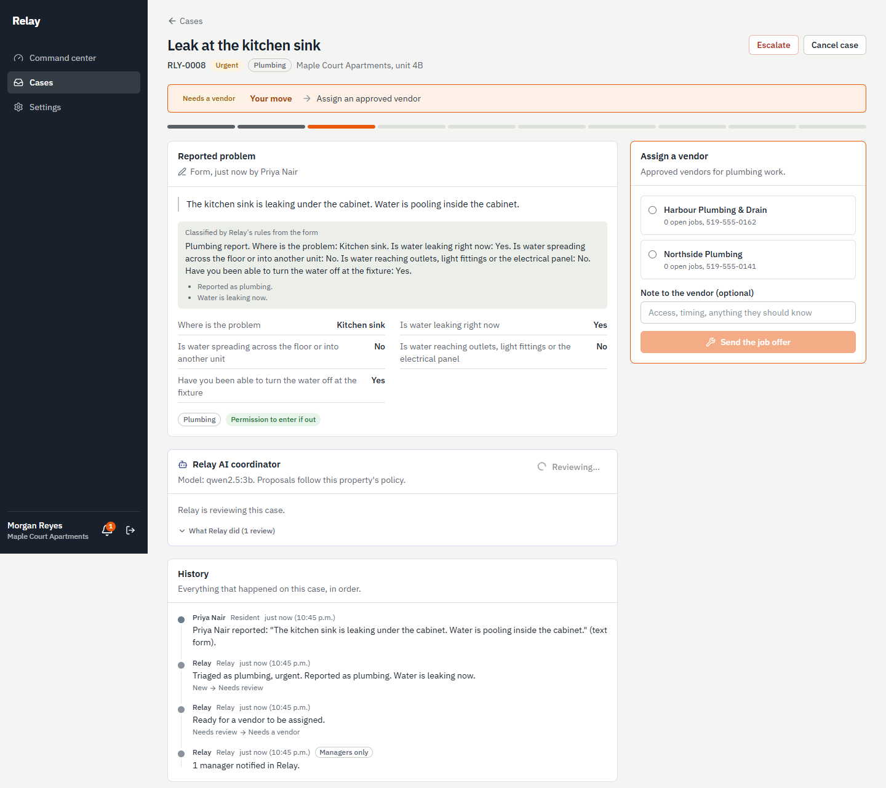

# Relay

Relay is an AI-assisted maintenance operations platform for residential buildings. A resident reports a problem in their own words. Relay understands it, files a work order, routes it to the right people, coordinates an approved contractor, enforces spending approvals, tracks the visit, and follows up until the resident confirms the fix.

**Every case has a state, an owner, a next action and a traceable outcome.** The interface makes that visible on every case, and the server enforces it.



## What it does

| Role | In Relay |
| --- | --- |
| **Resident** | Describes the problem to Relay's AI assistant in a chat, or by voice, or uses a plain form that works with no AI at all. Sees every update, chooses a visit time, and confirms whether the problem is actually fixed (or reopens it). |
| **Property manager** | Command center of what is waiting on whom. A searchable case inbox. A case detail with the resident's words, Relay's reading of the problem, its suggestions and the reasoning behind them, approvals, scheduling and the full history. Settings for policy, building notes and approved vendors. |
| **Contractor** | A phone-friendly job board with only their own jobs. Accept or decline offers, give a fixed estimate or say an inspection is needed, propose visit windows, start, post updates, report completion. |

It handles plumbing, appliances and heating/cooling with the same engine. Anything else is saved and goes to a person. Possible hazards (gas, smoke, sparks, flooding, water near electrics, no heat for someone at risk) are escalated to a manager and never dispatched as routine work.

## How the AI is used

The model is the reasoning engine; deterministic code holds the authority.

- **Intake agent:** converses with the resident and asks its own follow-up questions. It can look up the building's notes and the resident's recent reports, records what it learns as structured facts, and files the report through a tool. The server saves it; the resident's words are kept verbatim; safety rules can only raise the severity; the confirmation the resident sees is the server's result, never the model's paraphrase.
- **Coordinator:** an event-driven agent that wakes when a case needs a decision (ready for a vendor, a vendor declined, an offer expired, an estimate was rejected, "not fixed"…). It reads the case, the eligible vendors with their real workload and history, building notes and past cases through tools, then proposes. Policy decides what runs:
  - it can always escalate;
  - it can send a routine job offer only where a property opted into autopilot;
  - messages to residents and everything else wait for a manager;
  - it can never approve spending, schedule, close or cancel.

  Every run is stored with each tool call and its real result, and managers see "What Relay did" on the case.

The agents use any OpenAI-compatible endpoint. By default that is a **local Ollama model (`qwen2.5:3b`), free and offline**. Without a model the form and the whole manual workflow still work, and the UI says the assistant is offline.

## Run it locally

Requirements:

- WSL2 or Linux, with Node.js 24.22.1 or later;
- Docker, for Postgres and the local model;
- the Wasp CLI 0.22: `npm i -g @wasp.sh/wasp-cli@0.22.0`.

```bash
# 1. The local model (one time; about 2 GB)
docker run -d --name relay-ollama -p 11434:11434 -v relay-ollama:/root/.ollama ollama/ollama
docker exec relay-ollama ollama pull qwen2.5:3b

# 2. The app
cd app
cp .env.server.example .env.server        # defaults work; voice and tracing keys are optional
wasp start db                             # terminal 1: Postgres in Docker
wasp db migrate-dev && wasp db seed       # terminal 2, once: schema and demo accounts
wasp start                                # client http://localhost:3000, server http://localhost:3001
```

Sign in at http://localhost:3000 with a demo account. Every account uses the password `relay-demo-2026`.

| Username | Role | Where |
| --- | --- | --- |
| `priya`, `daniel` | Resident | Maple Court Apartments, units 4B and 2B |
| `noor` | Resident | Birch House, unit 101 |
| `morgan` | Property manager | Maple Court Apartments |
| `taylor` | Property manager | Birch House |
| `sam` / `jo` | Contractor | Northside Plumbing / Harbour Plumbing & Drain |
| `ana` / `lee` | Contractor | BrightSpark Appliance Repair / Evergreen Heating & Cooling |

All people, properties and vendors are fictional. No cases are seeded: every case is created through the app.

## Tests

| Command (from `app/`) | What it covers |
| --- | --- |
| `npm test` | Unit tests for the state machine, triage safety rules, intake validation, approval and overlap rules. |
| `npm run test:api` | HTTP tests against a running server started with `RELAY_TEST_HOOKS=true`. Covers the full resident-to-resolution journey across three roles, a second category, authorization, invalid transitions, races, appointment conflicts, deadlines via the durable sweep, emergency escalation and an injected database failure. **These reset all cases.** |
| `npm run test:api -- tests/api/agent.test.ts` | The intake agent and the coordinator against the real model. Takes minutes on a CPU. |
| `cd e2e && npm install && npx playwright test` | The acceptance journey in real Chrome: resident, manager and contractor each in their own browser, working the same case to RESOLVED. |

Current results, with exact commands and output, are in [STATUS.md](STATUS.md).

## Documentation

- [Architecture](docs/architecture.md): components, the case engine, agents and policy, durability, authorization.
- [Workflow](docs/workflow.md): the state machine, who holds a case in each state, approvals, scheduling and verification.
- [Status](STATUS.md): what is implemented, what was tested and how, what is blocked or missing.
- [Screenshots](docs/screenshots/).
- [Hackathon archive](docs/archive/): the original YC × ElevenLabs hackathon documents. The hackathon build is tagged `hackathon-final`.

## Built with

Wasp 0.22 (React, Node, Prisma, PostgreSQL, pg-boss jobs, username and password auth), Tailwind CSS 4 with components in the shadcn/ui pattern (Radix, class-variance-authority), Lucide icons, Ollama or any OpenAI-compatible model, ElevenLabs Agents for voice, TraceRoot for tracing, Playwright and the Node test runner.

Relay started at the YC Startups × ElevenLabs hackathon (November 2026). Contributors: Sandeep Kumar, Luke, Niranjan Hablani, Elaine.
