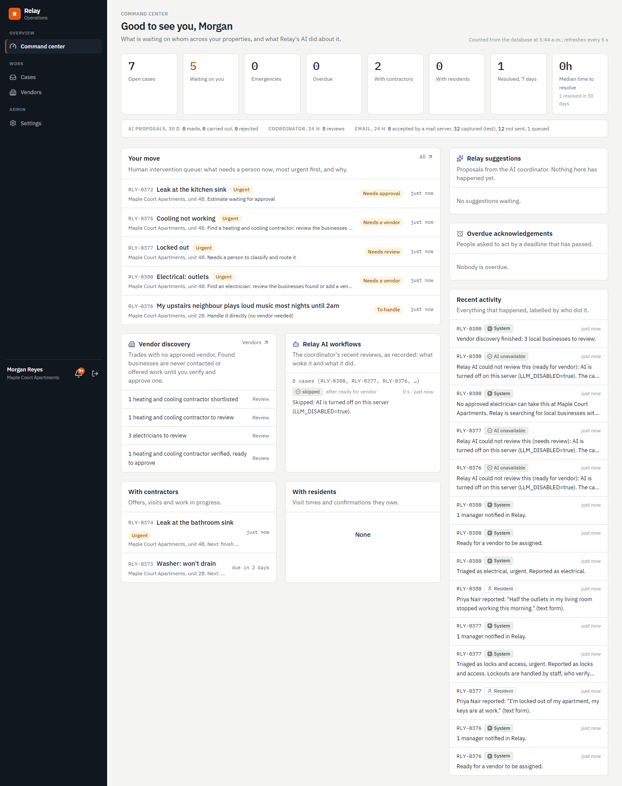
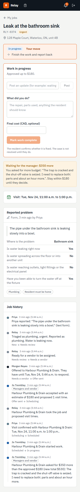
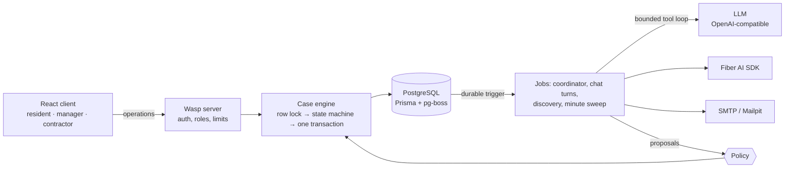

# Relay

Relay is an AI-assisted operations platform for residential buildings. A resident reports a problem in their own
words. Relay:

- understands it and files a case;
- routes it to the right people;
- finds and coordinates an approved contractor, or discovers local businesses when the building has none;
- enforces spending approvals and tracks the visit;
- follows up until the resident confirms the fix.

**Every case has a state, an owner, a next action and a traceable outcome.** The model reads and proposes;
deterministic code decides what can happen, and every decision is recorded and labelled by who made it.


## Demo

- **[Technical walkthrough (4 min 49 s, MP4)](https://github.com/elaineh16/yc-hackathon/releases/download/relay-v1.1-preview/relay-technical-walkthrough.mp4)**
  covers the architecture, the case engine, event-driven agents, policy, vendor discovery, follow-ups, security,
  the AI evaluation and the tests. It is narrated and captioned.
- **Product demo:** a resident, a manager and a contractor on one case, from report to verified fix. The scripts in
  [`app/e2e/demo`](app/e2e/demo) record it from the running app (Chrome's own recording of real interactions; the
  only edits are cutting the model's thinking time, marked on screen, plus captions and narration). It is not
  recorded yet: it needs the full stack and the local model, see [the runbook](docs/demo/DEMO_RUNBOOK.md).

Scripts, shot list and captions are in [docs/demo/](docs/demo/). For a live walkthrough, follow
[docs/demo.md](docs/demo.md).

| Command center | Resident, on a phone | Contractor, on a phone |
| --- | --- | --- |
|  |  |  |

## What it does

| Role | In Relay |
| --- | --- |
| **Resident** | Reports by chat with Relay's assistant (asynchronous), by voice, or with a plain form that needs no AI. Gets an acknowledgement in-app and, if they opt in, by email. Chooses a visit time and answers "Yes, resolved" or "No, still having problems". |
| **Property manager** | A command center counted from the database: what needs a person and why, vendor discovery, AI workflows, overdue acknowledgements, activity. A case workspace that separates AI proposals from executed actions, vendor acceptances from people's confirmations, and waiting from failure. Plus a vendor directory per property, and policy settings. |
| **Contractor** | A phone-friendly job board: accept or decline, estimate, propose times, start, update, ask for more money (the manager decides), complete. |

- **Categories:** plumbing, appliances, heating and cooling, electrical, locks and access, elevators, noise and
  neighbours, and anything else (routed by a person).
- **Possible hazards:** gas, smoke, sparks, alarms, flooding, water near electrics, someone trapped or at risk, and
  violence are escalated to a manager, never dispatched as routine work.
- **Lockouts:** they go to staff for an identity check, and no code is ever shared.

## How the AI is used

The model reasons; code holds the authority. Details: [docs/agents.md](docs/agents.md).

- **Intake agent:** converses, asks before filing vague reports, keeps what the resident said apart from what it
  assumed, files several problems at once, and reopens a repair that did not hold instead of opening a duplicate.
  The server saves the report, the safety rules can only raise severity, and the reply after filing is the
  server's, never the model's.
- **Coordinator:** wakes on case events, reads the case, the property's approved vendors, discovered businesses,
  building notes and past cases, then proposes. Policy decides:
  - offers only to approved vendors (automatically only under the property's autopilot for routine cases);
  - resident messages only after a grounding check and a manager's approval;
  - escalation at once only when the safety rules agree;
  - it never approves money, schedules, closes, cancels, or contacts a discovered business.
- **Models:** any OpenAI-compatible endpoint. The default is a local Ollama model (`qwen2.5:3b`): free, offline and
  private. Without a model, the form, discovery, notifications and every manual action still work.

**Measured, before and after:** 99 intake and 14 coordinator cases with expected and prohibited behaviour, 30
held-out cases in each of two independently written sets, deterministic and live-model runs. Results:
[docs/ai-eval.md](docs/ai-eval.md).



## Trust and reliability

- **Exactly once:** every write locks the case row, checks the transition and commits in one transaction.
  Idempotency keys and partial unique indexes make retries and double submits harmless.
- **The AI is one bounded actor:**
  - the state machine allows it only to offer approved vendors and to escalate;
  - nothing else it proposes happens without policy or a person;
  - every tool call is recorded.
- **Nothing silent:**
  - a lost job is re-queued by the minute sweep;
  - a failed AI review is reported to the manager;
  - a failed chat turn is retried and always answered;
  - an outage (model, Fiber, SMTP) degrades to the manual path, and the case says so.
- **Honest records:** each event shows who did it (resident, AI, system, manager, vendor), and each notification
  its real delivery state.
- **Reviewed:** a security review (1 high, 8 medium) with every finding fixed or documented, and regression tests;
  see [docs/security.md](docs/security.md).

## Vendor discovery (Fiber AI)

When a property has no approved vendor for a trade, Relay searches for local businesses with Fiber AI (official
SDK).

- **What is sent:** only the trade and the city.
- **What it does with results:** checks each one (business? right trade? in the area? contact details? already a
  vendor?) and shows a manager reasons that cite only the listing.
- **Cost controls:** a balance check, a reserve, a daily budget, a 14-day cache, and at most 3 businesses kept.
- **Authorization:** nothing found is contacted or offered work until a manager verifies it and approves it for the
  property.
- **Never blocking:** a missing key, an empty balance or an outage never blocks a case; managers can always add a
  vendor by hand.

Details: [docs/fiber.md](docs/fiber.md).

## Follow-ups

In-app notifications always; email (plain SMTP, opt-in) for things that need someone. Covered:

- acknowledgement of a report;
- actions with a deadline and what happens if it passes;
- visit times;
- visit reminders;
- "is it fixed?";
- bounded reminders, after which a manager is told once;
- "Relay cannot proceed", with what is missing.

Every delivery is recorded as what it really was. A local test inbox counts as "captured", never "delivered".
Details: [docs/notifications.md](docs/notifications.md).

## Run it locally

Requirements:

- WSL2 or Linux with Node.js 24.22.1+;
- Docker;
- the Wasp CLI 0.22: `npm i -g @wasp.sh/wasp-cli@0.22.0`.

```bash
# 1. Optional services (free, local)
docker run -d --name relay-ollama -p 11434:11434 -v relay-ollama:/root/.ollama ollama/ollama   # the model
docker exec relay-ollama ollama pull qwen2.5:3b
docker run -d --name relay-mailpit -p 1025:1025 -p 8025:8025 axllent/mailpit                    # email capture, UI on :8025

# 2. The app
cd app
cp .env.server.example .env.server     # set FIBER_MODE=fixture (or FIBER_API_KEY) and the SMTP_* lines to use them
wasp start db                          # terminal 1: Postgres in Docker
wasp db migrate-dev && wasp db seed    # terminal 2, once (if it waits on a terminal: add < /dev/null)
wasp start                             # client http://localhost:3000, server http://localhost:3001
npx tsx scripts/demo-data.ts           # optional: a populated demo (needs RELAY_TEST_HOOKS=true; resets cases)
```

**Local development only:** `wasp db seed` creates these fictional demo accounts, all with the password
`relay-demo-2026`. Never seed them into a shared or production database; real accounts come from the property.

| Username | Role | Where |
| --- | --- | --- |
| `priya`, `daniel` | Resident | Maple Court Apartments, units 4B and 2B (Priya has email on; Daniel has it off) |
| `noor` | Resident | Birch House, unit 101 |
| `morgan` | Property manager | Maple Court Apartments |
| `taylor` | Property manager | Birch House |
| `sam` / `jo` | Contractor | Northside Plumbing / Harbour Plumbing & Drain |
| `ana` / `lee` | Contractor | BrightSpark Appliance Repair / Evergreen Heating & Cooling |

All people, properties and vendors are fictional. Email addresses use the reserved `.test` domain. Maple Court has
no approved heating and cooling vendor on purpose, so the discovery flow can be shown. The demo walkthrough is in
[docs/demo.md](docs/demo.md).

## Tests

| Command (from `app/`) | What it covers |
| --- | --- |
| `npx tsx --test tests/unit/*.test.ts` | State machine, safety rules, intake validation, approval and overlap rules, staff-only notes and the reply guard |
| `npx tsx --test --test-concurrency=1 tests/api/*.test.ts` | Over HTTP against a server with `RELAY_TEST_HOOKS=true` (resets cases): the resident-to-resolution journeys, authorization, races, deadlines, vendor discovery (fixtures), follow-ups and email (Mailpit), V1.1 rules and security. `agent.test.ts` needs the model |
| `npx tsx tests/eval/deterministic.ts --gate` | The AI evaluation's deterministic part, over all cases, with a safety gate |
| `npx tsx tests/eval/live.ts --variant v1.1` | The intake agent on the live model (slow on CPU) |
| `cd e2e && npx playwright test journey` | The browser journeys in real Chrome |

CI (`.github/workflows/ci.yml`) runs the type-check, unit tests, the deterministic eval, every API suite and the
browser journeys against Postgres and Mailpit, with discovery on fixtures and no model.

**Current results:**

| Check | Result |
| --- | --- |
| Unit tests | 34 / 34 |
| API tests over HTTP | 85 / 85 |
| Browser tests in Chrome | 16 / 16 |
| GitHub Actions | green |
| Held-out emergencies escalated, live, by the whole system (out of sample) | 11 / 13 (the rules alone: 7) |
| Live coordinator: forbidden attempts that policy let through | 0 |

Exact commands, logs and every metric: [STATUS.md](STATUS.md) and [docs/ai-eval.md](docs/ai-eval.md).

## Known limitations

- **Fiber:** no live Fiber call has been made (no key was available). Discovery runs the real SDK path on
  Fiber-shaped fixtures.
- **The model:** the default is a small local model on CPU. It over-escalates some ordinary reports (5 of 24 in the
  live evaluation) and is slow.
- **Out-of-sample misses:** two of 13 held-out emergencies were missed out of sample (see the evaluation).
- **Not exercised:**
  - a real SMTP server;
  - voice with a live microphone;
  - a deployment.
- **Not built:** password reset and account management.

Details: [STATUS.md](STATUS.md).

## Documentation

- [Architecture](docs/architecture.md)
- [Workflow and states](docs/workflow.md)
- [Agents, tools and policy](docs/agents.md)
- [Vendor discovery](docs/fiber.md)
- [Follow-ups and notifications](docs/notifications.md)
- [AI evaluation](docs/ai-eval.md)
- [Security review](docs/security.md)
- [Feature matrix](docs/feature-matrix.md)
- [Demo walkthrough](docs/demo.md), and the [demo videos: scripts, shot list, runbook](docs/demo/)
- [Status](STATUS.md)
- Screenshots: [desktop, tablet and phone](docs/screenshots/v1.1/)
- [Hackathon archive](docs/archive/): the original YC × ElevenLabs hackathon documents. The hackathon build is
  tagged `hackathon-final`.

## Built with

Wasp 0.22 (React, Node, Prisma, PostgreSQL, pg-boss), Tailwind CSS 4 with shadcn-style components (Radix), Lucide,
IBM Plex. Agents run on Ollama or any OpenAI-compatible model. Also ElevenLabs Agents (voice), the Fiber AI
TypeScript SDK (vendor discovery), nodemailer and Mailpit (email), TraceRoot (traces), Playwright and the Node test
runner.

Relay started at the YC Startups × ElevenLabs hackathon (November 2026). Contributors: Sandeep Kumar, Luke, Niranjan
Hablani, Elaine.
