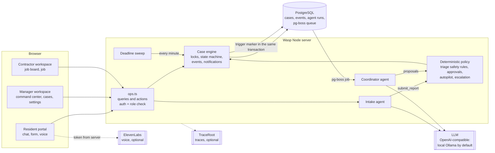

# Relay architecture

Relay is one Wasp 0.22 application in `app/`: a React client, a Node server generated by Wasp, and PostgreSQL through Prisma. Durable background work runs on pg-boss, which Wasp manages inside the same database.

## The rule that holds it together

Every case has a state, an owner and a next action, and only the case engine (`app/src/server/cases/engine.ts`) writes them. Each action:

1. locks the case row (`SELECT … FOR UPDATE`), so two actions on one case never interleave;
2. checks the caller may act on this case (`access.ts`): managers only on their properties, residents only on their own cases, contractors only on jobs offered to their vendor;
3. validates the transition against the shared state machine (`app/src/shared/machine.ts`);
4. writes the new status, its holder and next action, an append-only `CaseEvent`, and the notifications, all in one transaction.

If any step fails, nothing is saved. Partial unique indexes back the engine up in the database: at most one live vendor offer per case, and at most one confirmed visit per job. Repeating an action that already took effect returns `repeated: true` and changes nothing; an action that no longer applies returns 409.

## Agents: the model reasons, code decides

Both agents use any OpenAI-compatible chat-completions endpoint (`app/src/server/agent/llm.ts`). By default this is a local Ollama model (`qwen2.5:3b`), which is free and needs no account; `LLM_BASE_URL`, `LLM_MODEL` and `LLM_API_KEY` switch it to a hosted model. The loop in `agent/loop.ts` gives the model tools, validates every argument it sends, runs the tool, and feeds back the real result, including errors, until the model answers in plain text. Each run is stored in `AgentRun` with every tool call and its result.

**Intake agent** (`agent/intake.ts`). A resident describes a problem in their own words. The model decides what is still unknown and asks for it; the category checklists in `shared/intake.ts` are a guide in its prompt, not a script. It can look up the building's own notes, check the resident's recent reports, and record facts as structured metadata. It files with `submit_report`. Policy around it:

- the report is saved by the server only, and the reply after submission is the server's result text, so the model cannot claim a save that did not happen;
- the resident's own words are stored verbatim as the case description;
- a non-emergency report needs a confirmed read-back first (two resident turns);
- the agent's classification goes through the deterministic safety rules, which can only raise severity: any hazard in the resident's words or any safety concern the agent noted escalates the case.

**Coordinator** (`agent/coordinator.ts`). Transitions that need a decision (case ready for a vendor, vendor declined, offer expired, estimate rejected, resident declined the times, not fixed, reopened, escalated, resumed) write a durable marker on the case in the same transaction. After commit, a pg-boss job runs the coordinator, which reads the case, the eligible vendors with their real workload and history, the building notes and past cases through tools, then proposes. Deterministic policy decides what each proposal may do:

| Proposal | What policy allows |
| --- | --- |
| Offer the job to a vendor | Validated: approved vendor, right trade, not someone who already declined or lapsed on this case, case waiting for a vendor, not an emergency or under review. Sent automatically only for ROUTINE cases at a property that turned on autopilot and only to a vendor with a login; otherwise held for a manager. |
| Message the resident | Always held for a manager, who can edit it before sending. |
| Escalate | Always allowed: it is the safer direction. Only a person can resume. |
| Record an assessment | Stored on the case for managers, labelled as AI. |

The coordinator can never approve spending, schedule, close or cancel; the state machine does not let the `AGENT` actor do those things. If the model is unreachable the run is recorded as SKIPPED with the reason, the case continues manually, and a manager can ask for a review later.

## Durability

Deadlines are timestamps on rows, not timers in memory. A pg-boss cron job runs `sweepDeadlines()` every minute: it expires unanswered vendor offers, reminds residents to confirm a fix, tells managers when the confirmation window has passed, nudges on approvals that have waited a day, and re-queues any coordinator trigger that a crash or restart left behind. Every step re-checks state under the case lock, so running the sweep twice changes nothing the second time.

## Authentication and authorization

Wasp username-and-password auth. Self sign-up is blocked (`onBeforeSignup`); accounts are provisioned by the property, and the seed creates demo accounts. Every query and action starts in `ops.ts` with a role check, and every case read or write is checked again against the specific case. Anything a caller may not see returns the same 404 as a missing case. Residents never receive costs or management-only events; contractors see only their own assignment and the resident's first name.

## Voice

The resident's browser asks the server for a short-lived ElevenLabs conversation token; the API key never reaches the browser. The voice agent files through a client tool that calls the authenticated `submitVoiceReport` action, so voice reports pass the same checks as chat and form reports. Voice is optional: the form works with no AI at all.

## Observability

`server/tracing.ts` starts the TraceRoot SDK when `TRACEROOT_API_KEY` is set and fails open. Spans cover intake, every case transition, coordinator runs, voice sessions and the sweep. Attributes are ids, enum values and counts only; free text, error messages and credentials are never recorded.
