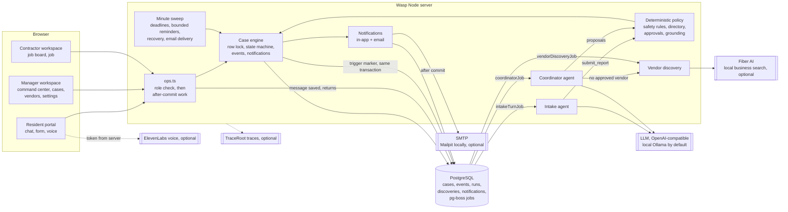

# Relay architecture

Relay is one Wasp 0.22 application in `app/`: a React client, a Node server generated by Wasp, and PostgreSQL through
Prisma. Durable background work runs on pg-boss inside the same database. There are no other services: email is
plain SMTP (Mailpit locally), and vendor discovery is an optional HTTPS API (Fiber AI).

## The rule that holds it together

Every case has a state, an owner (holder) and a next action, and only the case engine
(`app/src/server/cases/engine.ts`) writes them. Each action:

1. locks the case row (`SELECT … FOR UPDATE`);
2. checks the caller may act on this case (`access.ts`): managers only on their properties, residents only on their
   own cases, contractors only on jobs offered to their vendor;
3. validates the transition against the shared state machine (`app/src/shared/machine.ts`);
4. writes the new status, holder and next action, an append-only `CaseEvent`, the notifications, and the
   coordinator's trigger marker, all in one transaction.

If any step fails, nothing is saved. Partial unique indexes back it up in the database:

- one live vendor offer per case;
- one confirmed visit per job;
- one discovery in flight per case and trade.

Repeating an action that already took effect returns `repeated: true`. An action that no longer applies returns 409.

After the commit, `ops.ts` does three things outside the transaction:

- acknowledges the actor's open notifications on that case;
- queues the coordinator if a trigger was left;
- sends any email that became due.

A slow model or mail server never holds or rolls back a case action.

## The parts

| Part | Where | Details |
| --- | --- | --- |
| Case workflow and states | `cases/flow.ts`, `shared/machine.ts` | [workflow.md](workflow.md) |
| Intake agent, coordinator, policy, evaluation | `agent/*`, `cases/classify.ts`, `shared/triage.ts` | [agents.md](agents.md), [ai-eval.md](ai-eval.md) |
| Vendor directory and discovery | `vendors/*` | [fiber.md](fiber.md) |
| Follow-ups and notifications | `notify/*`, `cases/sweep.ts` | [notifications.md](notifications.md) |
| Read models (command center, case workspace) | `cases/read.ts`, `shared/views.ts` | below |
| Security review | | [security.md](security.md) |

## The vendor directory is per property

Vendors are companies shared across the portfolio, since their contractors log in and see jobs from any property.
Whether a vendor may be offered a property's work is decided per property (`PropertyVendor`). A manager sees, edits
and approves only vendors listed at the properties they run.

Discovered businesses are not vendors. They live in `VendorCandidate` until a manager verifies one and approves it
for the property.

## Background work

All of it is in the database, so a restart loses nothing.

| Job | What | Recovery |
| --- | --- | --- |
| `coordinatorJob` | One coordinator run per (case, trigger, event), claimed by a unique key | The sweep re-queues markers older than 90 s. A failed or interrupted run is not re-run (it may have acted); it is recorded on the case and the managers holding it are told |
| `intakeTurnJob` | One reply per resident message, claimed by a unique key; a 3-minute deadline per turn | A failed attempt is retried once; the sweep re-queues turns pending over 3 min; a run over 4 min old is taken over; the reply is written only while the turn is pending |
| `vendorDiscoveryJob` | One search per discovery, claimed `QUEUED` to `RUNNING` | Lost jobs are re-queued after 2 min; a run interrupted over 5 min is resumed from the saved response, and fails clearly after 3 attempts |
| `deadlineSweepJob` (every minute) | Offer expiry and reminders, visit-time reminders, visit reminders, verification reminders, approval reminders, emergency re-raise, the recoveries above, email delivery | Every step is locked or deduplicated, so running it twice changes nothing |

## Read side

`cases/read.ts` shapes what each role may see (`shared/views.ts`):

- Residents never receive costs, management-only events, discovery, change requests or internal next steps.
- Contractors see only their own assignment and the resident's first name.
- The manager's command center is counted from the database on each refresh:
  - key numbers, AI proposal outcomes, coordinator runs and email states;
  - the human intervention queue with reasons;
  - the discovery queue, overdue acknowledgements, AI workflows and activity.
- The case workspace shows the resident's words, Relay's reading (observed, assumed, unknown), discovery,
  every AI proposal and run with its outcome, vendors, approvals and budget requests, the visit, every notification
  with its delivery state, and the full history labelled by provenance.

## Authentication and authorization

- **Auth:** Wasp username-and-password. Self sign-up is blocked; accounts come from the property (the seed creates
  demo accounts).
- **Checks:** every operation starts with a role check in `ops.ts`, and every object is checked again (cases,
  candidates, vendors, notifications, conversations, proposals). Anything a caller may not see returns the same
  404 as a missing record.
- **Test hooks:** `/api/test/*` only exists with `RELAY_TEST_HOOKS=true` outside production, and its settings
  overrides are allowlisted (they can never switch on live Fiber calls).

## Voice and tracing

- **Voice:** the resident's browser gets a short-lived ElevenLabs token from the server. The voice agent files
  through a client tool that calls the authenticated `submitVoiceReport` action, under the same policy as chat.
- **Tracing:** TraceRoot spans carry ids, enums and counts only. Tracing fails open.
