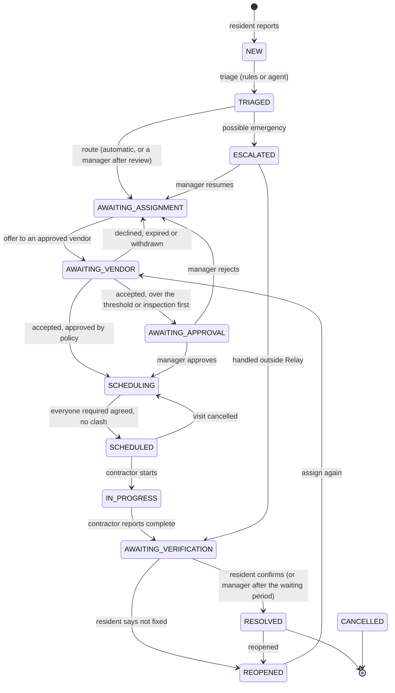

# Case workflow

The state machine lives in `app/src/shared/machine.ts`. The server enforces it (`cases/engine.ts`); the pages only read which actions are currently allowed.

Most open states can also move to `ESCALATED` (a manager or the coordinator) and to `CANCELLED` (the resident or a manager); a cancel releases any vendor offer or visit.

## Who holds the case

| Status | Holder | Next action |
| --- | --- | --- |
| NEW | Relay | Triage the report |
| TRIAGED | Manager | Review the report and route it |
| AWAITING_ASSIGNMENT | Manager | Assign an approved vendor |
| AWAITING_VENDOR | Contractor | Respond to the job offer (deadline set by the property) |
| AWAITING_APPROVAL | Manager | Approve or reject the estimate |
| SCHEDULING | Resident when there are times to choose, otherwise contractor | Choose a visit time / propose visit times |
| SCHEDULED | Contractor | Carry out the visit |
| IN_PROGRESS | Contractor | Finish the work and report back |
| AWAITING_VERIFICATION | Resident | Confirm whether the problem is fixed |
| ESCALATED | Manager | Handle the escalation |
| REOPENED | Manager | Review and assign a vendor again |
| RESOLVED, CANCELLED | No one | |

## Approvals and scheduling

- A contractor accepts with either a fixed estimate or "inspection first" (optionally with a fee), plus one to five visit windows.
- A fixed estimate at or below the property's approval threshold is approved by policy and recorded as such. A higher estimate, or any inspection-first response, waits for a manager, who approves a maximum (not below the estimate) or rejects it. A rejection releases the vendor and returns the case to assignment.
- The resident can pick a window while the approval is pending. The visit is confirmed only when both conditions hold: the spending is settled and the resident has chosen. Confirmation re-checks, under a per-vendor lock, that neither the vendor nor the unit already has a confirmed visit at an overlapping time. On a clash the window is marked unavailable and the contractor is asked for new times.
- A contractor's final cost above the approved maximum is flagged to managers.

## Verification and closing

Completing work only hands the case to the resident; it never resolves it. The resident confirms the fix (resolved) or says it is not fixed (reopened). The minute sweep reminds them on the property's schedule. A manager may close a case as unverified only after the property's waiting period, and the history records that it was closed without confirmation.

## History

Every transition and every meaningful action writes a `CaseEvent` with the actor's role and name, the time, the status change and a plain message. The audience controls who sees it:

- **EVERYONE:** the resident, the manager and the vendor on the job.
- **MANAGEMENT:** for example the policy reasons and AI proposals.
- **VENDOR:** managers and that vendor.

Nothing is ever updated or deleted in this history.
